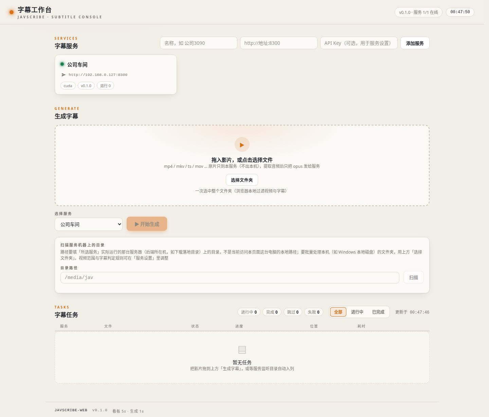

# JavScribe 字幕工具

JavScribe 是 JavdBviewed 系列下的**日语→中文字幕生成工具**：ja→zh 一步翻译（ASR+翻译合一）、
`.zh.srt` 原位落位、下载目录监听、进度查询和远端只传音频处理。它不是媒体服务器或播放器；它把影片音轨交给字幕服务处理，再将字幕写回客户端侧的影片目录。

> **JavScribe 仓库只含代码与配置，不内置任何模型权重。** 需要什么模型、去哪下载、放到哪里，
> 见 [部署指南](./deployment)。

## 它解决什么问题

影片（BT/PT 下载、网盘落地等）进库后通常没有中文字幕。JavScribe 把这条链路自动化：

```
 下载落盘目录 (mkv/ts/mp4/...)
      │  目录监听（文件大小稳定才接手，避免半截下载）
      ▼
 JavScribe 流水线
   ├─ 预检: 已有 <影片名>.zh.srt → 跳过
   ├─ [可选] JASNA 马赛克修复
   ├─ 字幕引擎: ChickenRice「海南鸡」Whisper (ja→zh 一步到位, CTranslate2, CUDA/CPU)
   ├─ 落位: <影片名>.zh.srt 写到客户端影片同目录，供媒体库扫描
   ├─ [可选] LLM 润色第二遍 (任意 OpenAI 兼容端点)
   └─ [可选] Emby Refresh API 联动
      │
      ▼
 进度接口 /health /jobs (HTTP)  +  远端处理: 只传提取的音轨，不传整片
```

## 特性

- **一步 ja→zh**：直接用「海南鸡」（TransWithAI ChickenRice）日转中专用模型 + 为这类素材调过的 VAD，不经过「通用 ASR + LLM」两遍
- **媒体库友好**：输出 `<影片名>.zh.srt`（可按配置调整），与影片同目录；媒体库重新扫描后可按对应影片查找字幕
- **下载目录监听**：文件大小稳定检测（下载未完成不接手）、存量文件可一次追平、已生成字幕自动跳过
- **进度可见**：进度精确到影片时间轴（"已翻到 47:12 / 共 150:20"），HTTP 接口随时查询；批量一次加载模型
- **远端处理**：客户端提取音轨交给 Serve 推理，再接收字幕；音轨大小取决于片长等因素，不以固定体积估算网络用量
- **客户端工作台**：浏览器看板看进度、页面生成字幕（浏览器本地提音轨、只把音轨发给服务）、批量文件夹扫描入队、页面上管理服务端设置项；同一产品两种形态（Docker Web / 桌面安装版），可挂多台服务端做自动均衡

## 部署机和用户电脑

JavScribe 的“文件在哪台机器上”取决于入口，不取决于浏览器地址栏显示的域名：

| 入口 | 实际读取或写回的位置 | 适用场景 |
| --- | --- | --- |
| Web 工作台的**扫描目录** | 客户端 Web 所在的部署机，以及映射到该机的目录 | 批量处理下载机上的影片；浏览器用户不需要把该目录挂到自己的电脑 |
| Web 工作台的**选择文件/文件夹** | 打开工作台的浏览器所在电脑 | 选择用户电脑上的单个影片或文件夹；浏览器提取音轨后上传 |
| JavScribe Client 桌面版 | 安装客户端的用户电脑 | 本机扫描、处理和把 `.zh.srt` 写回本机影片旁 |
| JavScribe Serve | GPU 或模型服务器 | 接收客户端上传的音轨、执行推理并返回字幕，不是用户侧文件浏览器 |

Web 形态的客户端可以和 Serve 在同一台机器，也可以分开；桌面客户端则把工作台放在用户电脑上。把浏览器电脑的 `D:\Videos` 或 `/home/user/videos` 填入 Web 工作台的扫描目录，不代表服务端能访问该路径；应使用客户端部署机的实际路径或“选择文件/文件夹”入口。远端处理默认只上传抽取出的音轨，不上传整片。

## 角色与形态

**服务端**只负责模型与模型渠道的对接、处理客户端传过来的音轨；**客户端**负责用户侧的
扫描、音轨提取与上传。两个角色、三种形态：

| 角色 | 形态 | 跑在哪 | 端口 | 职责 |
|---|---|---|---|---|
| 服务端 | JavScribe `serve`（headless） | GPU 服务器 | 8300 | 模型推理、ASR 生成、音轨上传接收、任务队列/调度、进度/设置/扫描 API |
| 客户端 | 字幕工作台 · Docker（Web） | 任意一台内网机器（可与服务同机） | 8400 | 浏览器看板、生成字幕、扫描「客户端部署机」目录、下载 srt、管理服务设置 |
| 客户端 | JavScribe Client · 桌面安装版 | 用户电脑（exe / AppImage / deb） | —（内嵌服务） | 同一套界面；扫描与写回以本电脑为准，无需另开浏览器 |

要点：

- **客户端是同一个产品、两种形态**：同一套前端代码、同一版本号，Web 无独立发布 tag。
  Docker 形态适合「在部署机上开浏览器管理」，
  安装版适合「本地双击即用、字幕写回本地磁盘」。
- **服务端无图形界面**：所有可视化（看板、设置、更新提示）都落在客户端前端；
  服务端的新版本提示同样显示在客户端的服务卡片上。
- **多台服务端可挂同一个客户端**：「⚖ 自动均衡」把新任务实时分给在途任务最少的在线服务。
- **多个客户端可连同一台服务端**：任务状态以服务端为真源，每个客户端都是
  「视图 + 操作代理」；他端客户端提交的任务以「他端」标记显示，可看进度、可做服务端操作
  （暂停/重试/下载 srt），但字幕不会自动落回本机磁盘。

## 版本与发布

| 组件 | 版本 tag | 发布方式 |
|---|---|---|
| 服务端 | `serve-vX.Y.Z` | 独立演进；按服务端 tag 和发布入口核对可用安装方式 |
| 客户端（Web + 桌面形态） | `client-vX.Y.Z` | 两种形态同号同 commit；Web 形态没有独立 `web-v*` tag，部署机从客户端代码构建 |

当前已核客户端 `client-v0.2.66` 有公开正式 Release；服务端 `serve-v0.2.16` 只有已核源码 tag，未核到对应公开 Release 安装包。客户端版本同时覆盖桌面安装和 Web 工作台；服务端版本独立，不要因为两者数字接近就当成同一发布包。本文不固定未经核对的 exe、压缩包或镜像直链；请从 [JavScribe Releases](https://github.com/JavdBviewed/JavScribe/releases) 查看当次可用资产和发布说明。`serve-v0.2.16` 不能据此承诺存在现成安装包。

前端更新检查同时比对客户端与服务端的 GitHub Release：客户端新版本提示与卡片角标、
服务端版本落后提示都显示在客户端前端（服务端本身没有界面可提示）。

## 字幕工作台能做什么

按固定 tag 的客户端工作台，常用流程是：登记一个或多个 Serve 地址，选择或扫描影片，提交字幕任务，在看板查看进度，再下载或将完成的 `.zh.srt` 写回客户端侧目录。工作台还提供服务状态、任务筛选和批量操作，以及服务设置和字幕预览等入口；具体按钮和权限以当前客户端版本实际显示为准。

- 单个文件或浏览器文件夹：浏览器在本机提取音轨，再上传给选中的 Serve。
- 客户端部署机扫描：批量列出部署机目录中的视频，识别已有字幕后再入队；完成后字幕写回该部署机影片旁。
- 多服务端：同一工作台可以登记多台服务端并按负载分派新任务；服务端任务状态是共享真源。
- 多客户端：多个工作台可以连接同一台 Serve，共享任务视图和服务端操作；从另一客户端提交的任务，不会自动把字幕写入当前电脑的本地目录。

服务端只提供无图形界面的处理能力；工作台中的看板、设置、更新提示和文件入口属于客户端。先看[部署指南](./deployment)区分 Serve 与 Client，再看[客户端工作台](./workbench)确认路径和任务入口。

## 与 JavdBviewed 的关系

- JavScribe 产出的 `.zh.srt` 落在影片同目录，Emby 扫描后即可在看片端直接使用；
  配置了 `emby` 段的服务会在每个任务完成后自动触发 Emby Refresh
- 也可以完全脱离 JavdBviewed 独立使用（Jellyfin/Plex 或纯目录消费）
- 代码与许可：JavScribe 本体 MIT；仓库 [github.com/JavdBviewed/JavScribe](https://github.com/JavdBviewed/JavScribe)

## 下一步

- 第一台 GPU 服务器怎么部署 → [部署指南](./deployment)
- 客户端怎么用（登记服务 / 生成 / 扫描 / 设置 / 看板）→ [客户端](./workbench)
- 配置项全量清单（环境变量 / config.json / 服务设置白名单 / 客户端本机设置）→ [配置参考](./config)
- 常见问题（显存占用 / API Key / 路径不存在 / 字幕质量 / 多客户端…）→ [常见问题](./faq)
- 接口清单与安全边界 → [API 参考](./api)


