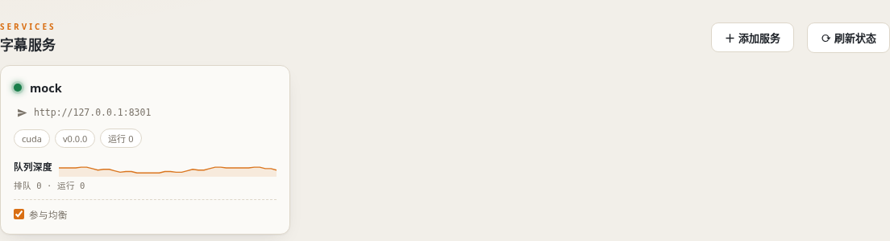
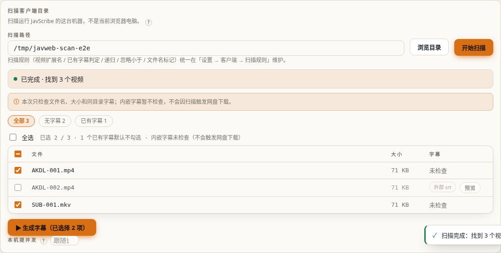
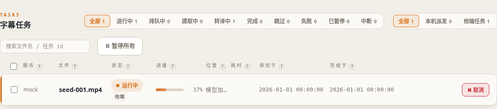

# 客户端

客户端是 JavScribe 的用户入口：**看板看进度、页面生成字幕、下载 srt、管理服务端设置项**。
部署见 [部署指南](./deployment)；本页讲怎么用。

本文以已核公开客户端 Release `client-v0.2.66` 的工作台实现为准。客户端是**同一个产品、两种形态**，共用 `client-v*` 版本体系，Web 没有独立的 `web-v*` tag：

| 形态 | 说明 |
|---|---|
| **Web**（Docker，默认端口 8400） | 部署在一台内网机器上，浏览器打开使用；「扫描目录」扫的是**这台部署机**的磁盘 |
| **桌面安装版**（exe / AppImage / deb） | 装在自己的电脑上双击使用；「扫描目录」扫的就是**本电脑**的磁盘 |

客户端聚合 N 台字幕服务端（每台 = 一个 `serve` 实例），纯 HTTP 轮询（5 秒一次）。
服务端是任务状态的单一真源，客户端是「视图 + 操作代理」；多个客户端连同一台服务端时，
各自可看到服务端任务（本工作台未提交的标为「他端」，见[多客户端](#multi-clients)）。
重启后的任务恢复另取决于服务端版本及数据目录，不能仅凭客户端版本断言全部任务会恢复。

## 1. 登记字幕服务

「字幕服务」页点「添加服务」，弹出表单填三项：

`client-v0.2.66` 的 E2E 测试界面示例，不是发布包实拍；图里 `v0.0.0` 为测试标识，`mock` 服务和本机地址均为测试数据。点击图中的「添加服务」再填写下列信息。

- **名称**：展示名，按你的设备命名（如 `字幕服务A`）
- **服务地址**：JavScribe `serve` 在客户端网络中可达的地址，如 `http://serve.example.com:8300`（仅地址格式占位；实际使用应限制在可信内网/VPN）
- **API Key**（可选）：与服务端 `JAVSCRIBE_API_KEY` 同一个值（只存客户端本地，接口不回显明文）

服务端 `JAVSCRIBE_API_KEY` 只用于 `/config`、服务端 `/scan` 等特定接口，
**不是全站鉴权**；客户端 `client-v0.2.66` 的「扫描目录」在工作台部署机本地执行，
不是服务端 `/scan`，不能说未填 Key 就无法扫描本机目录。看板和上传/进度接口也不能因填入 Key 就直接暴露到公网。
旧版服务镜像没有 `/config` 端点时，页面会提示「该服务版本过旧，不支持配置管理」。

## 2. 生成字幕：三种投喂方式

三种方式共用同一个服务选择，按「文件在哪台机器上」选：

### 方式一：单个文件（拖入 / 选择）

- 把影片文件拖进上传区或点选一个文件
- **浏览器所在电脑**提取音轨，只把音轨发给字幕服务，**原片不上传至服务端**；音轨大小随影片而变
- 进度三步可见：提取音轨 → 上传 → 服务端处理（看板里跟普通任务一样）

### 方式二：选择本机文件夹（批量）

- 点「选择文件夹」，在**你自己的电脑**上选一个目录（Chromium 内核浏览器，
  Chrome/Edge 可用；Firefox 不支持文件夹选择，请用单文件方式）
- 浏览器内按扩展名过滤视频、识别同目录已有字幕，
  chip 显示「N 个视频（M 个已有字幕，将跳过）」
- 开始后**顺序**逐个走单文件链路（文件 1/N · 2/N …）

> 前提：文件夹就在你打开页面的这台电脑上。浏览器只能读本地磁盘，
> 不能读服务器或其他电脑的目录——那种情况用方式三。

### 方式三：扫描目录（客户端部署机，批量）

- 在「扫描目录（客户端部署机）」填**客户端部署所在机器**可访问的绝对路径
  （Web 形态 = 运行 Web 工作台的机器或其容器已挂载的目录，如 `/media/jav`；
  桌面形态 = 本电脑路径），或点「浏览」直接选目录（免手填）
- 这个入口调用工作台本机的扫描接口，不依赖 Serve 的 `/scan` 或 Serve 所在机器的路径；
  扫描规则在**客户端设置**中配置，扫描结果逐行列出**字幕状态**并辅助判定：
  - `外部 srt`：同目录已有 `<片名>*.srt`（可点「预览」查看内容）
  - `内嵌 xx`：主动执行内嵌字幕检查时显示探测到的字幕轨；普通目录扫描不读取视频内容
  - `C 版（名）` / `无字幕（名）`：文件名带独立 `C`，按「文件名独立 C」语义判定
    （`C` 不与番号/CD 集数混排才算数，如 `XXX-123-c.mp4` = 无字幕版；
    语义可在扫描区切换：视为已压字幕 / 视为无字幕 / 关闭判定）
  - `⚠ 探测失败`：主动执行内嵌字幕检查时 ffprobe 异常，本次未检测到不代表没有内嵌字幕
- **小于阈值的文件**（默认 <200MB，扫描区「忽略小于」可调）：列出但不默认勾选，
  挡掉预告片与坏文件，仍可手动勾选

- 检测到已有字幕的文件默认不勾选；主动检查出内嵌字幕后也要复核选中状态；**勾选提交前会弹确认**（「已检测到 N 个文件
  带有字幕，是否继续生成」），确认后才入队。是否真的跳过仍由服务端的
  `subtitle.skip_if_exists` / `subtitle.skip_embedded` 策略兜底
- 勾选要处理的文件 → 提交，入队为本机扫描任务（逐文件提取音轨上传，
  看板显示「已入队 N 项（本机扫描）」）
- **完成后字幕自动落回客户端部署机的影片旁**（`<片名>.zh.srt`），行尾有回写状态
  标记（成功 / 已存在跳过 / 失败）
- 文件量大时分页浏览：默认 10 行/页，可切 10 / 20 / 50 / 100 / 500 档（记住偏好）；
  勾选态跨页保留

`client-v0.2.66` 的 E2E 测试界面示例，不是发布包实拍；同批截图中的 `v0.0.0` 为测试标识，路径和文件名均为测试数据。示例中「外部 srt」对应已有字幕，提交前请核对勾选项。

**路径属于哪台机器**（最常混淆的点）：

| 入口 | 路径在哪台机器上 | 例子 |
|---|---|---|
| 选择文件夹 | **浏览器所在的电脑**（桌面形态 = 本电脑） | `D:\Videos\JAV`（Windows） |
| 扫描目录（客户端部署机） | **客户端部署所在机器** | `/media/jav`（Linux） |

两者不要混填：浏览器电脑的盘符不能直接作为另一台 Web 工作台部署机的目录。
容器化部署时，工作台只能读取容器可访问的路径。`client-v0.2.66` 的 Web 工作台也支持在
**客户端容器内**设置 `JAVSCRIBE_HOST_ROOT`：当原路径不存在时，可尝试解析该容器已只读挂载的
宿主机路径；只读映射不允许字幕写回，需另行提供可写的对应目录。服务端同名变量用于
Serve 自身 `/scan`，不能让 Web 工作台凭空读取服务端的文件系统。

**工作台本地扫描规则在「客户端设置」中调整**（对后续扫描生效）：

- `video_exts`：视频扩展名列表（默认 11 种：mp4/mkv/avi/mov/webm/flv/wmv/ts/m2ts/mpg/mpeg）
- `subtitle_patterns`：已有字幕判定后缀（默认 `.zh.srt`、`.srt`）
- `recurse`：是否递归子目录（默认开）
- 内嵌字幕检查需另行主动触发；普通目录扫描不读取视频内容，不能将普通扫描结果当成内嵌轨检测结论

## 3. 服务设置

服务卡片右上角「⚙ 服务设置」按 schema 渲染服务端白名单设置项。
**每项的默认值、取值范围与作用，逐项说明见 [配置参考 · 白名单](./config)。**

- 弹窗顶部**「组件就绪」卡片**（serve v0.2.6+）：打开即拉取服务端自检，
  逐项显示 ASR 模型 / VAD / 特征提取器 / ffmpeg / GPU 驱动 / 磁盘空间
  （必需项）与监听目录 / 润色 / Emby / JASNA / 外网代理（可选项），
  顶部汇总「全部就绪 / 存在未就绪项」+ 服务版本 + 设备；只做本地检查
  （文件/命令/磁盘），不探测网络连通性
- 表单顶部横幅提示：**服务端级设置影响所有连接该服务的客户端**
  （「客户端设置」卡片例外，只保存在本机）
- 敏感项（API Key 等）打码显示；保存时类型校验，通过后写回配置文件活动
  profile 段 + 内存热更，**对之后新提交的任务生效**（不影响正在跑的任务）
- 客户端代理请求时自动携带该服务的 API Key，页面不接触明文 Key
- 设置项带「?」帮助图标，悬浮显示该项的作用与取值说明
- 最常调的两项：**转译并发数**（服务端同时转译任务数，按显卡显存调 1~4）
  与 **VAD 阈值**（字幕出现大段重复/幻觉时调高到 0.6~0.7，见
  [常见问题](./faq)）

**客户端设置**（本机，不经过服务端）：音轨提取并发（本机同时跑 ffmpeg 的数量，
1~8 封顶）、转译并发（服务队列上限，1~16）——多人共用一台客户端部署机时，
这里控制的是**这台机器**的 ffmpeg 并发与派发队列深度。

## 4. 任务看板

看板每 5 秒轮询一次，汇总所有服务的任务 + 本机扫描管线任务；
每行 = 服务 / 文件 / 状态 / 进度 / 位置 / 耗时。进度精确到**影片时间轴**
（"已翻到 47:12 / 共 150:20"），不是字节百分比。

`client-v0.2.66` 的 E2E 测试界面示例，不是发布包实拍；同批截图中的 `v0.0.0` 为测试标识，任务与时间均为测试数据。图示只用于定位筛选、进度与行级操作。

### 筛选与统计

- **状态筛选**（与计数合一，每档带实时数量）：全部 / 进行中 / 排队中 / 提取中 /
  转译中 / 完成 / 跳过 / 失败 / 已暂停
- **来源筛选**（多客户端场景）：全部 / 本机派发 / 他端任务——仅当存在他端客户端
  提交的任务时出现，否则自动收起
- **分页**：默认 10 行/页，可切 10 / 20 / 50 / 100 / 500 档（记住偏好），
  前端即时翻页；页码越界自动收回
- 已完成任务的「预览 srt」：弹窗按字幕时间轴渲染（序号 + 起止时间 + 文本），
  长字幕自动折行，可滚动查看

### 行级操作

| 操作 | 适用行 | 说明 |
|---|---|---|
| `↓ 下载 srt` | 已完成 | 手动下载生成的字幕 |
| `预览 srt` | 已完成 | 弹窗查看字幕时间轴 |
| `暂停` / `继续` | 进行中 / 已暂停 | 服务侧挂起/恢复单任务（任务内任一文件运行中时暂停被拒绝） |
| `重试` | 失败 / 已暂停 | 重提取音轨并重提交 |
| `取消` | 排队 / 进行中 | 从队列移除 |
| `改派` | 本机排队 / 暂停行 | 改绑目的地服务或「⚖ 自动均衡」（实时生效，服务行不可改道） |
| 「他端」标记 | 他端客户端提交的服务任务 | 可看进度与做服务端操作；源视频不在本机，字幕不会落回本机磁盘 |

### 批量操作（400+ 场景）

- 行首勾选（表头可全选当前筛选集）→ 底部出现批量操作条：
  **暂停 / 继续 / 重试 / 取消 / 改派**，一次作用于所有勾选项
- 顶栏「⏸ 暂停所有 / ▶ 继续任务」：本机管线闸 + 代理所有在线服务队列暂停
  （**服务端级操作**：所有连接这些服务的客户端都会看到队列挂起，弹窗有警示）

### 服务端负载与服务卡

- 服务卡片带 **GPU 利用率 / 队列深度迷你趋势图**（最近 120 点，5 秒采样）
- 「⚖ 自动均衡」：新任务派发时实时分给**在途任务最少**的在线服务；
  服务卡上的「参与均衡」勾选可把某台临时移出均衡池（只收手动指定的任务）

## 5. 字幕下载与写回源目录

任务完成后拿 srt 有三条路，按投喂方式自动匹配：

| 投喂方式 | 字幕在哪 | 你要做什么 |
|---|---|---|
| 扫描目录（客户端部署机） | **客户端部署机上的影片同目录**（自动落回，行尾有回写状态标记） | 什么都不用做 |
| 选择文件夹（Chrome/Edge） | 勾选「完成后自动下载字幕」时，**自动写回你选的源目录**（`<片名>.zh.srt`） | 什么都不用做 |
| 单个文件 / 其他浏览器 | 浏览器下载目录 | 手动把 srt 放到影片同目录（或手动点 `↓ 下载 srt`） |

- 「完成后自动下载字幕」开关默认**关闭**，开启后记住偏好（localStorage）
- 写回源目录依赖 Chromium 的 File System Access API（目录句柄），
  其他浏览器或句柄不可用时自动降级为浏览器下载，并有 toast 提示
- 浏览器下载无法直接写进你选的那个文件夹，提示里会说明「请放到影片同目录」
- 桌面安装形态不依赖浏览器写回：完成后字幕直接写回本地影片旁

## 6. 多客户端连同一台服务端 {#multi-clients}

多台客户端（Web / 桌面）可以同时登记同一台（或多台）服务端，设计约定：

- **服务端是任务状态真源**，每个客户端都是「视图 + 操作代理」。
  **仅对 `serve-v0.2.16` 源码/自行构建版本**：启用持久数据目录后，服务端将任务历史写入 `jobs.json`，
  重启时只恢复已处于终态且未被清理的历史（内存显示仍有窗口上限）；未完成、在途任务不恢复执行，须重新提交。
  此结论不适用于未经核实的旧版公开服务端包，特别不能由 `serve-v0.2.15` 推断相同行为。
- 他端客户端提交的任务：看板以虚线「他端」标记显示，**可看进度、可下载 srt、
  可做服务端操作**（暂停/继续/重试/取消）；但源视频不在本机，
  **字幕不会自动落回本机磁盘**（本机扫描任务的回写标记只属于本机管线）
- **服务端级操作对所有人可见**：「暂停所有」会代理暂停所有在线服务队列，
  其他客户端会看到同一批任务挂起（操作前有警示弹窗）
- 各客户端自己的偏好（服务登记表、API Key、筛选/分页/阈值等）独立保存，互不影响
- 客户端保存本工作台提交过的任务 ID，用来区分「本机」与「他端」；
  服务端重启后，已完成历史能否显示要看**实际 Serve 版本及持久数据目录**，
  尚未完成的任务需要在确认源文件和字幕状态后重新提交，避免重复生成

实现口径：客户端固定 `client-v0.2.66` 的 `web/src/jav_scribe_web/localscan.py`、
`web/src/jav_scribe_web/api.py`；任务恢复只依据 `serve-v0.2.16` 的
`src/jav_scribe/core/engine.py`，不是所有公开服务端安装包的共同承诺。
